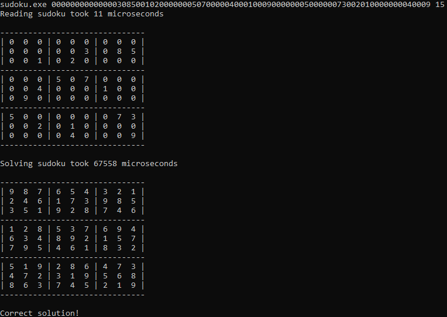

<h2>Sudoku solver with heuristics</h2>

A simple application that implements a sudoku-solving algorithm in C with following heuristics:
- Minimum Remaining Value - select the cell with the fewest possible candidates first, as it is most constrained and reduces branching in the search space.
- Naked Pairs - if two cells in the same row, column, or box contain only the same two candidates, those numbers can be eliminated from all other cells in that unit.
- Hidden Pairs - if two numbers appear as candidates in exactly two cells within a row, column, or box (even if other candidates are present in those cells), all other candidates in those cells can be removed.
- Least Constraining Value - when filling a cell, prioritize the value that eliminates the fewest options for remaining empty cells, helping to maintain flexibility in future placements.

The application allows for choosing which heuristics to use (or disabling heuristics), counts processing time and validates the solution.

